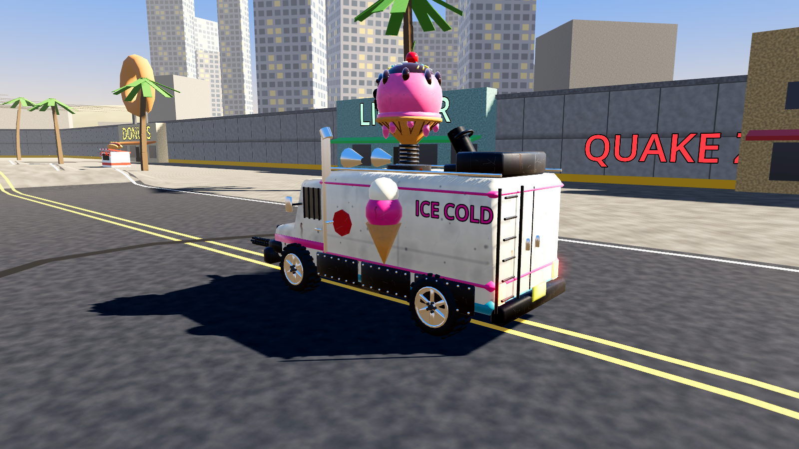
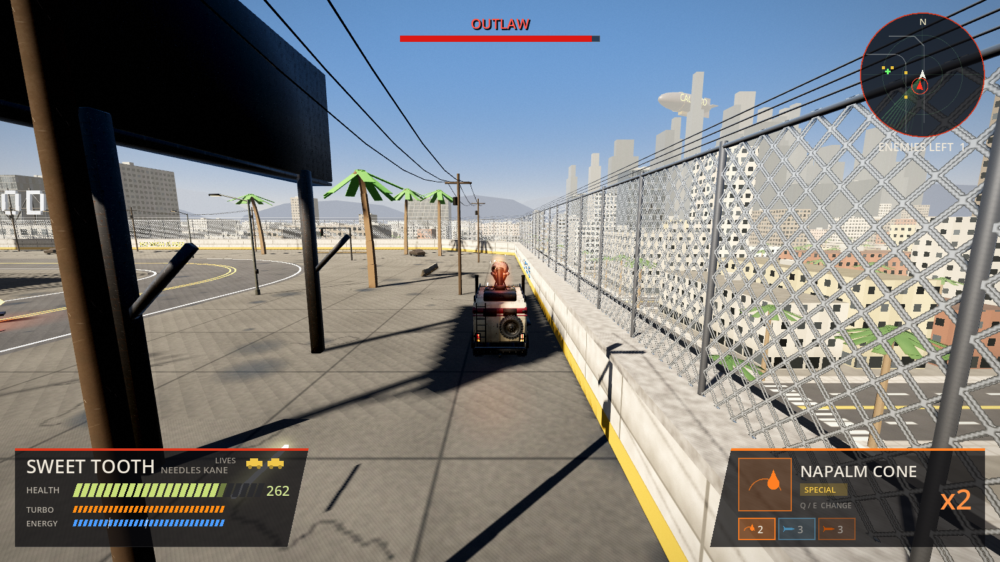

# Twisted Metal — Junkyard Prototype

A vehicular-combat game in the spirit of *Twisted Metal* (stages and characters from TM2 and Head-On,
direction and gameplay from Black), made in **Godot 4.3**. All cars and stages are built in code.

## Play it
1. Download **Godot 4.3** (standard build, not .NET): https://godotengine.org/download/archive/4.3-stable/
2. Open Godot, click **Import**, choose this folder's `project.godot`.
3. Press **F5** (or the play button).

Goal: destroy Outlaw and Junkyard Dog with Sweet Tooth. Last car running wins.

| Action | Keys |
|---|---|
| Drive | W A S D (or arrows) |
| Handbrake slide | Space |
| Turbo | Shift |
| Machine guns | J / left mouse |
| Fire weapon | K / right mouse |
| Change weapon | Q / E |
| Jump / Freeze (energy) | C / F |
| Look back | B |
| Pause / Restart / Help | Esc / Enter / F1 |

Gamepads work too (RT gas, LT brake, A guns, X weapon).

## Music
Put `.ogg` or `.mp3` files into `audio/music/`. The first file (alphabetically) plays in a loop.

## Screenshots
| | |
|---|---|
|  |  |
|  |  |

The game uses Godot's Compatibility renderer (OpenGL), which runs on most PCs including older
or integrated graphics.

## For developers
- Design document: [docs/GDD.md](docs/GDD.md)
- Project notes, conventions and status: [CLAUDE.md](CLAUDE.md)
- Tests: `godot --headless --path . -s tests/smoke_test.gd`
