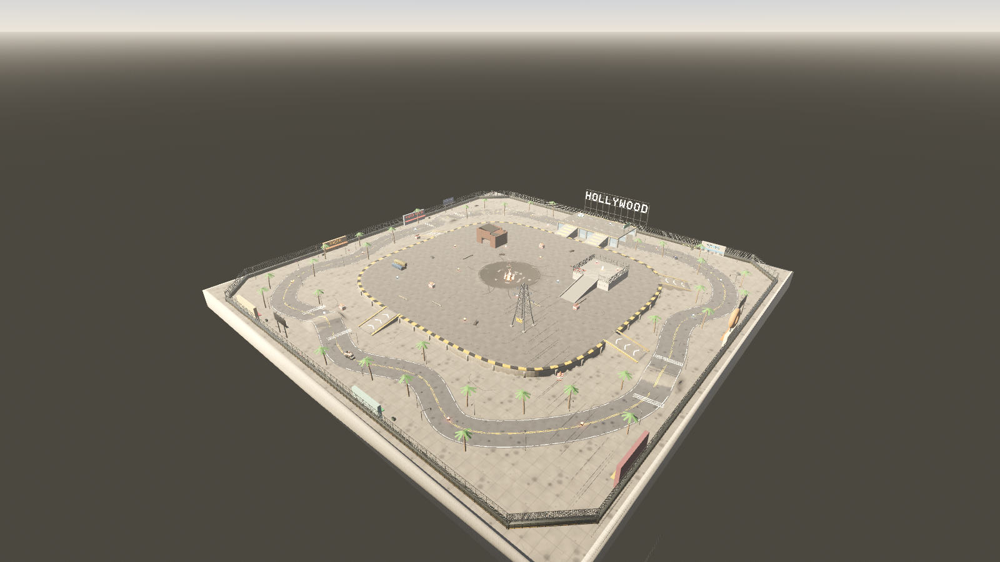
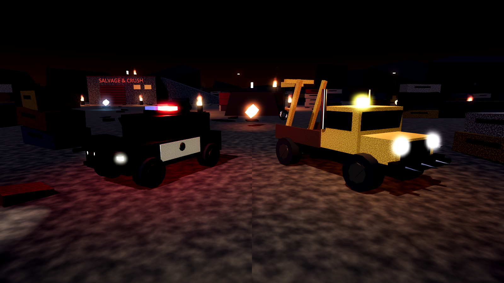
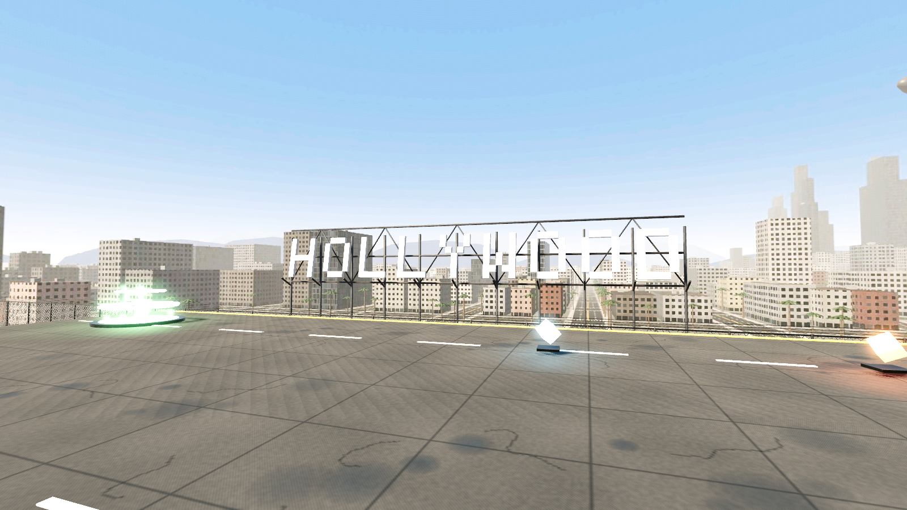
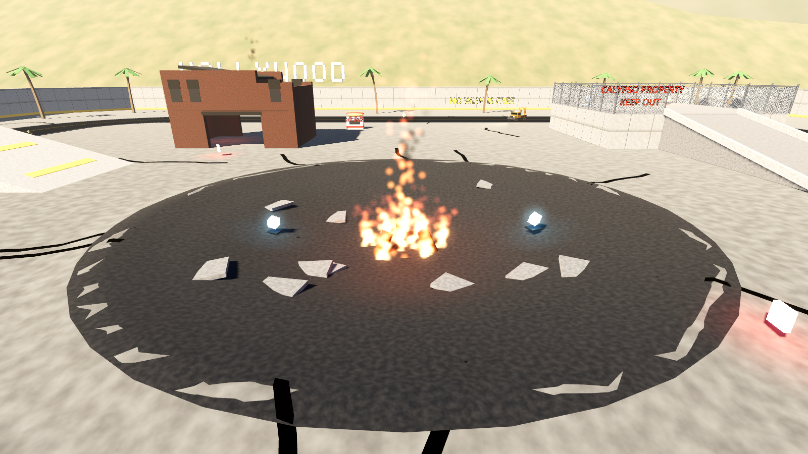

# Twisted Metal — Los Angeles Test Stage

A vehicular-combat game in the spirit of *Twisted Metal* (stages and characters from TM2 and Head-On,
story and gameplay feel from Black, bright TM2-style lighting), made in **Godot 4.3**. All cars and
stages are built in code.

## Play it
1. Download **Godot 4.3** (standard build, not .NET): https://godotengine.org/download/archive/4.3-stable/
2. Open Godot, click **Import**, choose this folder's `project.godot`.
3. Press **F5** (or the play button).

Stage 1 is TM2's **Los Angeles: Quake Zone Rumble**. You drive Sweet Tooth against Outlaw, Junkyard Dog,
Mr. Grimm and Spectre. To try another driver, press **Esc** and then **1-5** (the stage restarts with
that car, and Sweet Tooth joins the AI). Last car running wins. You have **3 lives**: a wreck costs one and you are back in
the fight after 6 seconds; lose the last one and it's game over.

Things to find: the ramps onto the tunnel roof (weapons and a teleporter to the caged super health),
the overpass to the cage, the three humps on the south road (jump for the health above them), the
fire pit, hot dog stands and the power tower (shoot them for weapons), glass tunnel walls you can drive
through, and the HOLLYWOOD sign (shoot every letter from the tunnel roof).

| Action | Keys |
|---|---|
| Drive | W A S D (or arrows) |
| Handbrake slide | Space |
| Turbo | Shift |
| Machine guns | J / left mouse |
| Fire weapon | K / right mouse (special: press again to mash the taser or blow the chain bomb) |
| Change weapon | Q / E |
| Jump / Freeze (energy) | C / F |
| Look back | B |
| Pause / Restart / Help | Esc / Enter / F1 |
| Pick a driver (while paused) | 1 Sweet Tooth, 2 Outlaw, 3 Junkyard Dog, 4 Mr. Grimm, 5 Spectre |

Gamepads work too (RT gas, LT brake, A guns, X weapon).

## Music
Put `.ogg` or `.mp3` files into `audio/music/`. The first file (alphabetically) plays in a loop.

## Screenshots
| | |
|---|---|
|  |  |
|  |  |

The game uses Godot's Compatibility renderer (OpenGL), which runs on most PCs including older
or integrated graphics.

## For developers
- Design bible (Arabic, for the owner): [docs/design/](docs/design/README.md)
- Game design document: [docs/GDD.md](docs/GDD.md)
- Project notes, conventions and status: [CLAUDE.md](CLAUDE.md)
- Tests: `godot --headless --path . -s tests/smoke_test.gd`
- The old Junkyard prototype stage: `godot --path . -- junkyard`
